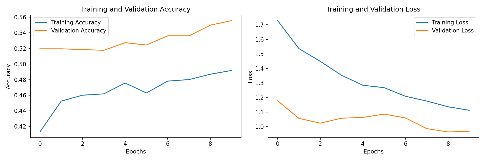
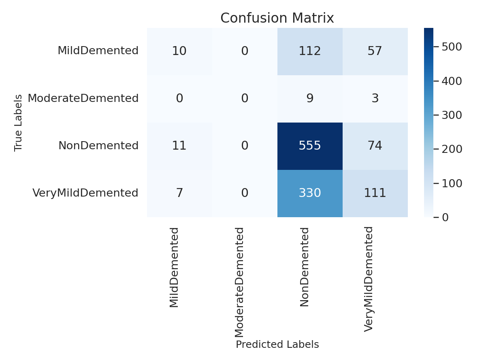
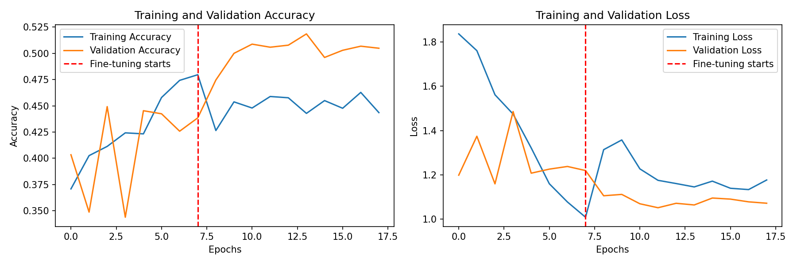
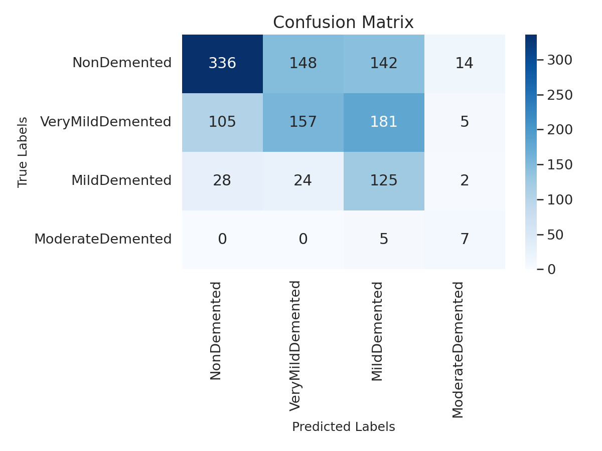

# Alzheimer's Disease Classification from MRI Images

A deep learning project, built with Keras, that classifies brain MRI images into four classes and compares a baseline convolutional network (CNN) with a transfer learning model:

- `NonDemented`
- `VeryMildDemented`
- `MildDemented`
- `ModerateDemented`

## Background

Alzheimer's disease is a progressive neurodegenerative disease and [the most common form of dementia (WHO)](https://www.who.int/news-room/fact-sheets/detail/dementia). It causes memory loss, cognitive decline and changes in behaviour that get worse over time.

Many people first go through a stage of [mild cognitive impairment (NIA)](https://www.nia.nih.gov/health/memory-loss-and-forgetfulness/what-mild-cognitive-impairment), between normal age-related changes and dementia: memory or other cognitive problems are more noticeable than usual, but daily life is still largely independent. Some people in this stage later develop Alzheimer's disease, others remain stable.

Brain MRI scans can show changes linked to the disease. Classifying them automatically is an active research area for supporting early detection. This project is an educational exercise and not a diagnostic tool.

## Data

- **Inspiration:** [Classification of Alzheimers 95% TOTW (Kaggle)](https://www.kaggle.com/code/schorsi/classification-of-alzheimers-95-totw) by Neil Kloper.
- **Dataset:** `alzheimers-dataset-4-class-of-images`, by Sarvesh Dubey ([tourist55 on Kaggle](https://www.kaggle.com/tourist55)), as credited in that notebook. The folder name `Alzheimer_s Dataset` is the same. The dataset page is no longer publicly available, so the origin of the images could not be verified.
- The dataset is not included in this repository. It is expected in a folder named `Alzheimer_s Dataset` with a `train` and a `test` subfolder, each containing one folder per class.
- The classes are very unbalanced. Number of images in the copy used for this project:

| Class | `train` | `test` |
|---|---:|---:|
| `NonDemented` | 2,560 | 640 |
| `VeryMildDemented` | 1,792 | 448 |
| `MildDemented` | 717 | 179 |
| `ModerateDemented` | 52 | 26, of which 14 duplicates excluded by the notebook (see **Limitations**) |

## Approach

1. **Split:** 80% of the `train` folder for training, 20% for validation. The `test` folder is used only for the final evaluation.
2. **Augmentation:** rotation, shift, zoom and horizontal flip, as layers of the model that are active only during training.
3. **Model:** EfficientNetV2B0 pre-trained on ImageNet, followed by global average pooling, a dense layer with dropout and a softmax output.
4. **Class weights:** errors on rare classes count more during training.
5. **Training in two phases:** first only the new top layers are trained; then the last EfficientNet layers are also trained with a much lower learning rate. The best model is chosen by validation loss.
6. **Evaluation:** confusion matrix, per-class precision, recall and F1, and macro averages on the test set.

The [baseline CNN](https://github.com/elenasorrentino10/Alzheimer-Disease-Project/blob/4a5b9fe/Alzheimers_Classification.ipynb) used five convolutional blocks, 10 epochs and no class weights.

## Why these choices

| Choice | Reason |
|---|---|
| Separate `test` folder, used only at the end | The final score must come from images that played no part in training or in choosing the best epoch. |
| Test images identical to training images are excluded | A model must not be evaluated on images it has already seen. |
| Augmentation only during training | Validation and test must measure the model on unmodified images. |
| Same `seed` for the training and validation split | With [`image_dataset_from_directory`](https://keras.io/api/data_loading/image/), the same seed keeps the two parts from overlapping. |
| `shuffle=False` for the test set | Predictions stay in the same order as the true labels. |
| `image_dataset_from_directory` and augmentation layers | `ImageDataGenerator` is no longer available in Keras 3. |
| Per-class metrics and macro averages | With unbalanced classes, overall accuracy can look good while a rare class is missed. Micro averages would simply repeat the accuracy. |
| Baseline measured before improving the model | A correct evaluation of the original model gives a reference for judging any improvement. |
| [Class weights](https://www.tensorflow.org/tutorials/structured_data/imbalanced_data) | `ModerateDemented` has only 52 training images, and the baseline never predicted it. |
| Transfer learning | With about 4,000 training images, a pre-trained network starts from visual features already learned, instead of learning everything from scratch. |
| Training in two phases | The new top layers are stabilized first, so that large early updates do not damage the pre-trained weights. |
| Best model chosen by validation loss | With unbalanced classes, accuracy can improve just by favouring the most common class. |
| Four-class public dataset instead of ADNI | [ADNI](https://adni.loni.usc.edu/) data requires an application and a data use agreement. A first experiment with ADNI's three groups was stopped before completion and is not part of this project. |

## How to run

1. Open `Alzheimers_Classification.ipynb` in [Google Colab](https://colab.research.google.com/) and choose a GPU runtime.
2. Put the dataset in your Google Drive.
3. Set `DATA_DIR` in the notebook to the dataset folder.
4. Run all cells.

## Results

All results are on the test set of 1,279 images, after excluding the duplicates. Always predicting the most common class (`NonDemented`) would give an accuracy of 0.500, so accuracy alone is not enough to judge a model.

### Baseline CNN

| Metric | Value |
|---|---:|
| Accuracy | 0.529 |
| Precision (macro) | 0.340 |
| Recall (macro) | 0.293 |
| F1 (macro) | 0.273 |

| Class | Precision | Recall | F1 | Test images |
|---|---:|---:|---:|---:|
| `NonDemented` | 0.552 | 0.867 | 0.674 | 640 |
| `VeryMildDemented` | 0.453 | 0.248 | 0.320 | 448 |
| `MildDemented` | 0.357 | 0.056 | 0.097 | 179 |
| `ModerateDemented` | 0.000 | 0.000 | 0.000 | 12 |

The baseline is only slightly better than always predicting the most common class. It classifies most images as `NonDemented`, including 330 of the 448 `VeryMildDemented` images, and it never predicts `ModerateDemented`.

### Transfer learning with class weights

| Metric | Value |
|---|---:|
| Accuracy | 0.489 |
| Precision (macro) | 0.430 |
| Recall (macro) | 0.539 |
| F1 (macro) | 0.439 |

| Class | Precision | Recall | F1 | Test images |
|---|---:|---:|---:|---:|
| `NonDemented` | 0.716 | 0.525 | 0.606 | 640 |
| `VeryMildDemented` | 0.477 | 0.350 | 0.404 | 448 |
| `MildDemented` | 0.276 | 0.698 | 0.396 | 179 |
| `ModerateDemented` | 0.250 | 0.583 | 0.350 | 12 |

### Comparison

| Metric | Baseline CNN | Transfer learning + class weights |
|---|---:|---:|
| Accuracy | 0.529 | 0.489 |
| F1 (macro) | 0.273 | 0.439 |
| Recall (macro) | 0.293 | 0.539 |
| Recall `MildDemented` | 0.056 | 0.698 |
| Recall `ModerateDemented` | 0.000 | 0.583 |
| Recall `NonDemented` | 0.867 | 0.525 |

Accuracy went down while the balance across classes improved a lot: this is the expected effect of class weights, which make the model stop favouring the most common class. The improved model now finds more than half of the `MildDemented` and `ModerateDemented` images, at the cost of more false alarms on healthy cases.

The model is still weak and far from clinical use. Its mistakes are, however, mostly between neighbouring stages: 85% of the test images (1,090 of 1,279) are classified either correctly or in an adjacent stage. The `ModerateDemented` figures rest on only 12 test images.

## Limitations

- **Possible patient overlap:** the dataset does not say which patient each image belongs to. Images from the same patient may be in both `train` and `test`, which would make the results look better than they are.
- **Duplicates in the test set:** in the copy used for this project, 14 images in `test/ModerateDemented` (`moderateDem*.jpg`) are identical to images in `train/ModerateDemented`. The notebook compares the content of the files and excludes them from the evaluation, leaving 12 test images for this class. The original folders are not changed.
- **Very few `ModerateDemented` images:** results for this class are based on very few examples and are not stable.
- **No external validation:** the model is tested on a single dataset, not on data from other hospitals or scanners.

## Possible next steps

- External validation on independent data, as done for lung cancer in [Sybil (Mikhael et al., 2023)](https://pubmed.ncbi.nlm.nih.gov/36634294/).
- Splitting the data by patient, if a version of the dataset with patient identifiers becomes available.

The two-phase transfer learning approach was inspired by [Alzheimer-dementia-prediction (Kaggle)](https://www.kaggle.com/code/apalladi/alzheimer-dementia-prediction), a related project on the same four classes. When using pre-augmented datasets, it is important to check that test images are not the source of the augmented training images.

## Files

- `Alzheimers_Classification.ipynb`: the notebook
- `images/`: training curves and confusion matrices of the two models

## License

[MIT](LICENSE)
